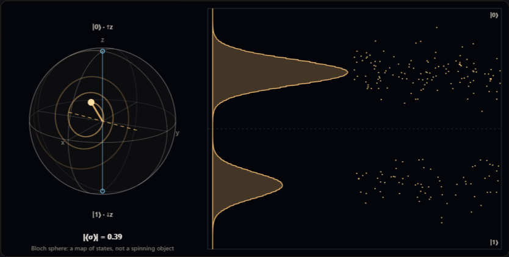
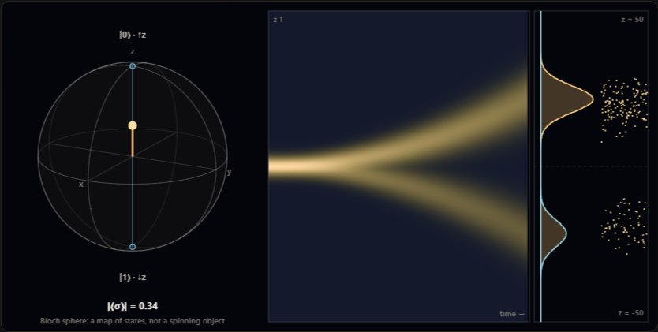
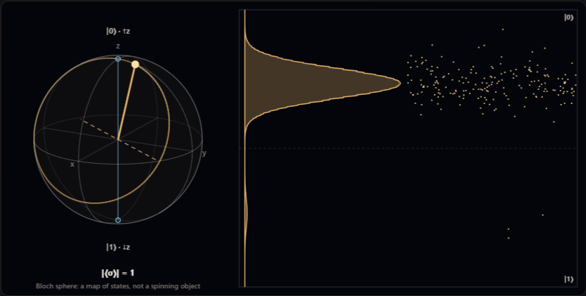

# quantum-spin-engine

Spin-½, qubits and Stern–Gerlach magnets for the browser and Node, with no dependencies.
Density matrices, an **exact** Lindblad propagator, Kraus channels, quantum-jump trajectories,
projective measurement, tomography, a two-component wave-packet solver and a Canvas 2D view with a
Bloch sphere. Every result is checked against an exact law or a second, independent method.

**[Live demo](https://fundamental.gmartos.es/quantum-spin-engine/demo/)**

| Driven qubit with relaxation | Stern–Gerlach beam splitting | Off-resonant Rabi oscillation |
| --- | --- | --- |
|  |  |  |

*Screenshots of the live demo. Nothing is pre-recorded: the state is propagated on every frame.*

- **Small complex matrices** of any size: products, Kronecker products, `expm` by scaling and
  squaring, `hermitianEigenvalues` by complex Jacobi rotations.
- **States**: kets, density matrices, `blochVector`, SU(2) `rotation`, purity, von Neumann entropy,
  fidelity, trace distance and partial trace.
- **Open systems**: `liouvillian` builds the Lindblad superoperator and `superPropagator` exponentiates
  it, so `applySuper` advances the ensemble with no time-step error. Kraus channels for dephasing,
  amplitude damping and depolarising. `createJumpUnraveling` produces quantum-jump trajectories whose
  average reproduces the master equation.
- **Measurement**: `measureAlong` any axis (probabilities, post-measurement states, unread mixture),
  seeded shot statistics and linear `tomography` of one qubit.
- **Stern–Gerlach**: `createSpinor` puts a spin-½ wave packet on a 1D grid and propagates each
  component with its own potential; `reducedSpin` traces out the position and shows the spin
  decohering as the beams separate.
- **View**: `createBlochRenderer` draws the Bloch sphere (state arrow, trail, rotation axis, analyser
  axis, samples), a beam map, the analyser screen with detections and a stage strip. It draws only
  what the frame carries.
- **Reproducible**: all randomness comes from a seeded generator; the same seed gives the same
  record, shot by shot.
- Plain ES modules, no build step, Node ≥ 20 or any current browser.

The sphere is a map of the possible states of a two-level system. It is **not** a picture of a
particle spinning: the renderer says so in its caption and never animates the sphere itself.

## Install

The package is not on npm yet. Clone the repository or copy `src/` into your project:

```sh
git clone https://github.com/ecomyseo/quantum-spin-engine.git
cd quantum-spin-engine
npm test          # no dependencies to install
npm run examples
```

```js
import { rotation, liouvillian, createSpinor } from './quantum-spin-engine/src/index.js';
```

## Quick start

### A driven qubit

In the rotating frame, `H = (Δ/2)·σz + (Ω/2)·σx`: the Bloch vector turns around the effective field
`(Ω, 0, Δ)` at the generalised Rabi frequency.

```js
import { blochToDensity, blochVector, rotation, evolve } from './src/index.js';

const omega = 1.5, delta = 0.8, dt = 0.02;
const step = rotation([omega, 0, delta], Math.hypot(omega, delta) * dt);

let rho = blochToDensity([0, 0, 1]);            // |0⟩, north pole
for (let i = 0; i < 200; i += 1) rho = evolve(rho, step);

const [, , z] = blochVector(rho);
console.log('P(|1⟩) =', 0.5 * (1 - z));        // (Ω/Ω′)²·sin²(Ω′t/2)
```

### Relaxation and dephasing

```js
import { PAULI, ket, densityFromKet, matrix, zeros, liouvillian, superPropagator, applySuper } from './src/index.js';

const T1 = 6, Tphi = 8, dt = 0.05;
const lower = matrix([[0, 1], [0, 0]]);         // |0⟩⟨1|
const L = liouvillian(zeros(2), [
  { operator: lower, rate: 1 / T1 },            // energy relaxation
  { operator: PAULI.Z, rate: 1 / (2 * Tphi) }   // pure dephasing
]);
const P = superPropagator(L, dt);               // exact for any dt

let rho = densityFromKet(ket([1, 1]));          // |+⟩
for (let i = 0; i < 100; i += 1) rho = applySuper(P, rho);
// coherence = e^(−t/T2), with 1/T2 = 1/(2·T1) + 1/Tφ
```

The same decay as individual realisations:

```js
import { createJumpUnraveling, createRng } from './src/index.js';

const unraveling = createJumpUnraveling(zeros(2), collapse, dt);
const rng = createRng('my-seed');
const trajectory = unraveling.start(ket([1, 1]), rng);
for (let i = 0; i < 100; i += 1) unraveling.step(trajectory, rng);   // returns the jump index or −1
const psi = unraveling.state(trajectory);                            // a pure state
```

### Measurement and tomography

```js
import { blochToDensity, measureAlong, tomography, axisFromAngles, createRng } from './src/index.js';

const rho = blochToDensity(axisFromAngles(60, 0));       // spin tilted 60° from z
measureAlong(rho, [0, 0, 1]).pUp;                        // cos²(30°) = 0.75
tomography(rho, 400, createRng('seed')).vector;          // estimate of ⟨σ⟩, may fall outside the sphere
```

### A Stern–Gerlach magnet

```js
import { createGrid, gaussianPacket, createSpinor, createSpinorPropagator,
         componentMoments, reducedSpin, blochVector } from './src/index.js';

const grid = createGrid({ size: 1024, length: 200 });
const spinor = createSpinor(grid, gaussianPacket(grid, { center: 0, sigma: 1.5 }),
                            [[Math.SQRT1_2, 0], [Math.SQRT1_2, 0]]);   // spin along +x
const f = 0.2;
const up = Float64Array.from(grid.x, (z) => -f * z);    // −f·z for spin up
const down = Float64Array.from(grid.x, (z) => f * z);   // +f·z for spin down
const propagator = createSpinorPropagator(grid, { mass: 1 });

for (let i = 0; i < 480; i += 1) propagator.step(spinor, up, down, 0.025);

componentMoments(grid, spinor.up).mean;     // +f·t²/2m = 14.4
blochVector(reducedSpin(grid, spinor));     // ≈ (0, 0, 0): the spin alone is now a mixture
```

### Drawing it

```js
import { createBlochRenderer } from './src/bloch-renderer.js';

// The renderer adds a `div.fq-stage` to the container; give that class a height in your CSS.
const renderer = createBlochRenderer(document.querySelector('#stage'), {
  labels: { caption: ['Bloch sphere: a map of states'], time: 'time →', decimal: '.' }
});

renderer.render({
  x, density,                     // profile on the analyser screen (z axis, vertical)
  view: [-3.2, 3.2],
  events,                         // detections, as positions on that axis
  screenLabels: ['|0⟩', '|1⟩'],
  bloch: { vector, trail, axis, measure, samples, ghost },
  circuit: { elements: [{ label: 'H', detail: '', flow: 1, blocked: 0 }], cursor: 0.4 },
  carpet: { columns, rows, times }  // beam map: one row of |Ψ(z)|² per instant
}, { strict: false, duration: 12 });
```

`strict: true` removes the trail, the samples and the reference state, leaving only the state and
the detector.

## API

| Module | Exports |
| --- | --- |
| `cmatrix` | `zeros`, `identity`, `matrix`, `clone`, `add`, `subtract`, `scale`, `multiply`, `dagger`, `conjugate`, `trace`, `kron`, `commutator`, `normOne`, `distance`, `expm`, `applyToVector`, `hermitianEigenvalues` |
| `density` | `PAULI`, `ket`, `ketNorm`, `densityFromKet`, `qubitKet`, `blochToDensity`, `blochVector`, `unitVector`, `axisFromAngles`, `spinAlong`, `rotation`, `evolve`, `expectation`, `purity`, `entropy`, `fidelity`, `traceDistance`, `mixture`, `partialTrace` |
| `open-system` | `liouvillian`, `superPropagator`, `applySuper`, `applyKraus`, `krausDefect`, `channel`, `createJumpUnraveling` |
| `measurement` | `axisProjectors`, `measureAlong`, `sampleUpCount`, `tomography` |
| `spinor` | `createSpinor`, `createSpinorPropagator`, `spinorDensity`, `componentMoments`, `reducedSpin` |
| `grid`, `split-step`, `fft`, `rng` | `createGrid`, `createState`, `gaussianPacket`, `createPropagator`, `createFft`, `createRng`, … |
| `bloch-renderer` | `createBlochRenderer`, `project`, `LABELS` |

Conventions: ħ = 1. A matrix is `{ n, re, im }` with row-major `Float64Array`s. `|0⟩` is spin up
along z and the first element of a ket; `ρ = ½·(I + r·σ)`. `rotation(axis, angle)` is
`exp(−i·angle·n·σ/2)` and turns the Bloch vector `angle` radians around `n`. In `liouvillian`, each
collapse entry is `{ operator, rate }` and contributes `rate·(LρL† − ½{L†L, ρ})`.

## How it is checked

`npm test` runs, with no dependencies:

- rotations from `expm` against the closed form and against Rodrigues' formula on the Bloch vector;
- Hermitian eigenvalues against exact cases and against the trace and the trace of the square;
- the master equation against T₁, T₂ and the steady state of a driven, damped qubit;
- Kraus channels against the master equation at the matching strength;
- the average of 3 000 quantum-jump trajectories against the Lindblad result;
- projective measurement against the half-angle law, and tomography against its statistical error;
- entropy, partial trace and trace distance on a Bell pair;
- Stern–Gerlach beam separation `f·t²/m`, beam momenta and the spin coherence
  `exp(−[(2ft)²σ²/2 + (ft²/m)²/8σ²])` of a minimum-uncertainty packet;
- the renderer with a spy canvas: where the state arrow ends, its length, what strict mode removes.

## Limits

- The Stern–Gerlach solver is one-dimensional: only the direction of the gradient, a constant force
  and no transverse precession. A real magnet cannot have a gradient along a single direction.
- Dense matrices: fine for a few qubits, not for many-body systems.
- Tomography is the plain linear estimator; it can return a vector outside the sphere, on purpose.
- Source comments and test names are in Spanish.

## Where it is used

The engine runs the spin, Stern–Gerlach and one-qubit scenarios of
[Fundamental Universe](https://fundamental.gmartos.es/escenarios.html#familia-informacion-cuantica),
an interactive physics laboratory in the browser.

## Licence

MIT © 2026 Gustavo Martos Ferri
